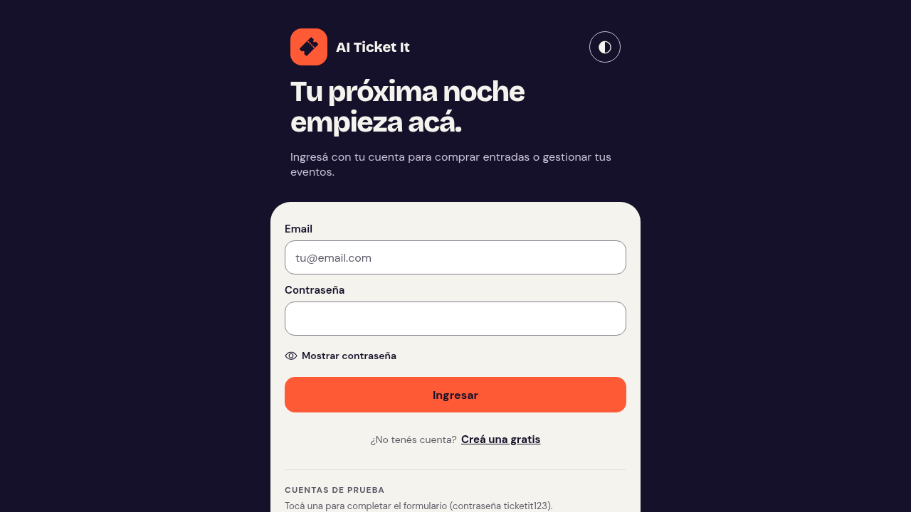
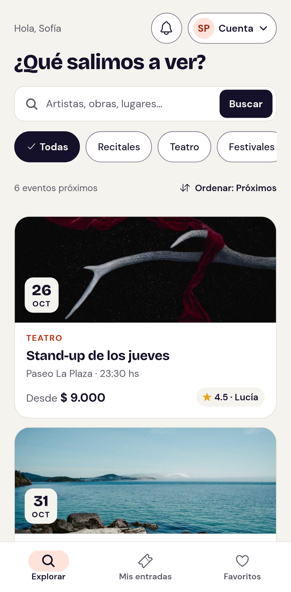
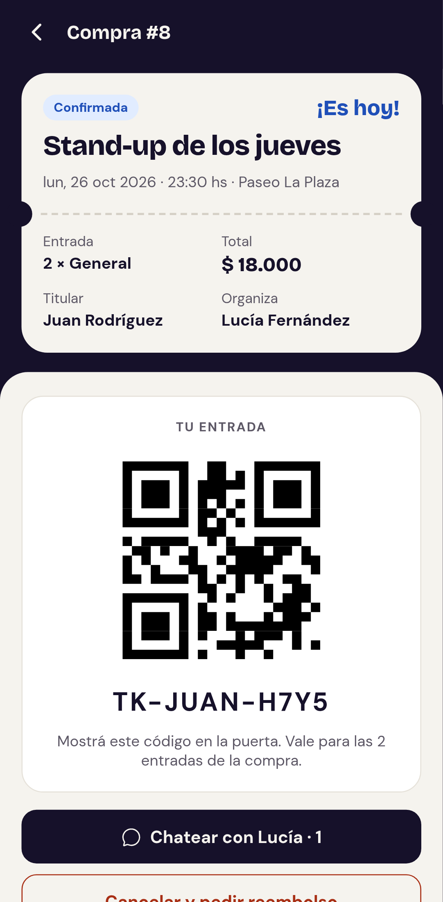
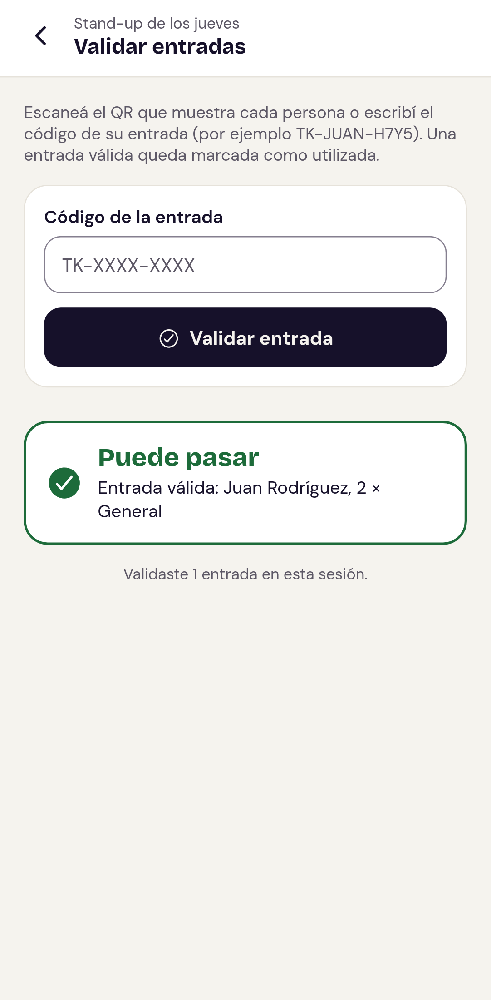
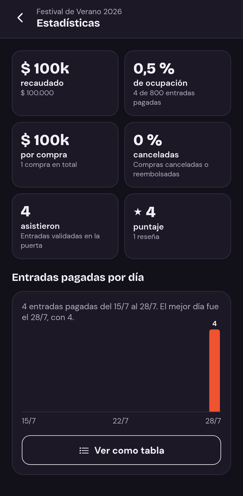
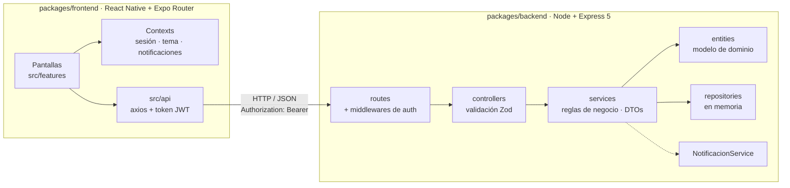

# AI Ticket It

Plataforma de venta de entradas para eventos — Trabajo Práctico de Desarrollo de Software (UTN FRBA, 2C 2026).
Esta es la **versión pro**: el TP completo más inicio de sesión real, gestión de eventos, notificaciones, entradas
con QR, estadísticas, Docker y CI. Las diferencias con el TP original están en [`docs/CHANGELOG.md`](docs/CHANGELOG.md).

| Comprador | Organizador |
|---|---|
| Busca y filtra eventos, guarda favoritos, compra con **cupones** y paga con tarjeta (**checkout** simulado), tiene **15 minutos** para pagar, se anota en la **lista de espera** si está agotado, chatea **en vivo** con el organizador, **transfiere** o cancela su entrada, la muestra con **QR** en la puerta, **comparte** el evento o lo agrega al **calendario** y lo califica. | Publica eventos con **fotos subidas** desde el dispositivo, los **edita y cancela**, crea **cupones**, ve ventas, **estadísticas** y la lista de espera, responde chats, **valida entradas** escaneando el QR y lee las reseñas. |

Además: cuentas con **email y contraseña** (con recuperación por código), **notificaciones** dentro de la app,
**estados de carga** según la situación (esqueletos, barras, imágenes progresivas) y **MSW** para probar con
latencia o sin backend, modo oscuro, y accesibilidad WCAG 2.2 AA verificada con axe en cada pantalla. Funciona
en el celular (Expo Go) y en el navegador.

<p>
  
  
  
  
  
</p>

## Arquitectura

Monorepo con npm workspaces. El backend sigue la arquitectura en capas del repositorio de clase.



```
ticket-it-pro/
├── packages/
│   ├── backend/     # API REST (Express 5, Zod, JWT, Swagger) · Dockerfile
│   └── frontend/    # App React Native + Expo (web y mobile) · Dockerfile + nginx
├── specs/           # Una spec por módulo (SDD + historias de usuario), M0 a M24
├── docs/            # Bitácora de decisiones (D-01 a D-45), alcance, changelog y capturas
├── docker-compose.yml
└── .github/workflows/ci.yml
```

| Capa | Tecnologías |
|---|---|
| Backend | Node 22, Express 5, Zod 4, bcryptjs + jsonwebtoken, helmet, express-rate-limit, swagger-ui-express |
| Frontend | Expo SDK 58, React Native 0.88, React 19, Expo Router, axios, expo-secure-store, expo-camera, react-native-qrcode-svg |
| Calidad | Jest + Supertest, Playwright + axe-core, ESLint (React + hooks), Prettier, GitHub Actions |
| Infraestructura | Docker (usuario sin privilegios, healthcheck), nginx, docker compose |

## Puesta en marcha (desarrollo)

Requisitos: Node.js 20 o superior. Para el celular, la app **Expo Go** en la misma red WiFi que la PC.

```bash
npm install
cp packages/backend/.env.example packages/backend/.env
npm run start:web   # backend + app en el navegador
npm run start:dev   # backend + Expo (escaneá el QR con Expo Go)
```

- App web: `http://localhost:8081`
- API: `http://localhost:3000` · **Swagger UI: `http://localhost:3000/api-docs`**

Para probar la API en Swagger: `POST /auth/login` con un usuario de prueba, copiar el `token` y pegarlo en
**Authorize**.

**Estados de carga y MSW** (D-39), dentro de `packages/frontend`:

```bash
npm run web:lento        # MSW demora cada llamada al backend real (ver esqueletos y barras de carga)
npm run web:mock         # la app SIN backend, con datos generados desde la API real
npm run mocks:generar    # regenera esos datos si cambia el backend
```

La app detecta sola la IP de la PC cuando corre en Expo Go. Si hiciera falta forzarla, crear
`packages/frontend/.env` con `EXPO_PUBLIC_API_URL=http://<IP-de-la-PC>:3000`.

## Con Docker

```bash
cp .env.example .env              # poné un JWT_SECRET propio: openssl rand -hex 32
docker compose up --build
```

- Web: `http://localhost:8080` · API: `http://localhost:3000/api-docs`
- Si esos puertos están ocupados: `API_PORT=3600 WEB_PORT=8600 docker compose up --build`

El backend corre en modo producción: exige `JWT_SECRET` (32+ caracteres) y deshabilita `POST /dev/reset`.

## Usuarios de prueba

Todos con la contraseña **`ticketit123`**. En la pantalla de ingreso, "Cuentas de prueba" completa el formulario.

| Email | Usuario | Rol | Para probar |
|---|---|---|---|
| `lucia@ticketit.com` | Lucía Fernández | Organizadora | 2 notificaciones sin leer, validar entradas del evento de hoy, estadísticas |
| `martin@ticketit.com` | Martín Gómez | Organizador | |
| `sofia@ticketit.com` | Sofía Pérez | Compradora | compras en los 5 estados, chat con mensajes |
| `juan@ticketit.com` | Juan Rodríguez | Comprador | entrada **`TK-JUAN-H7Y5`** para el stand-up de hoy; compra 6 utilizada sin reseñar |

Más datos para la demo:
- **Cupones**: `INDIE20` (20 %) e `INDIE2X1` (2×1) en Noche Indie; `RISAS` ($ 2.000) en el stand-up.
- **Tarjetas de prueba**: `4242 4242 4242 4242` aprobada · `4000 0000 0000 0002` rechazada (sin fondos).
- **Lista de espera**: comprá la última Platea del superclásico con un usuario y anotate con otro.
- **Recuperar contraseña**: el código llega al email simulado (consola del backend o `GET /dev/emails`).
| `valentina@ticketit.com` | Valentina López | Compradora | |

Los datos viven en memoria: se reinician al reiniciar el backend, o con `POST /dev/reset` en desarrollo.

## Scripts

| Comando | Qué hace |
|---|---|
| `npm run verificar` | lint + formato + tests del backend (lo mismo que corre el CI) |
| `npm run test:backend` | 251 tests (Jest + Supertest) |
| `npm run test:coverage` | tests con cobertura (umbral 90 % líneas / 80 % ramas) |
| `npm run test:e2e` | 262 tests E2E + accesibilidad con axe, en web, mobile, modo oscuro y sin backend (MSW) |
| `npm run lint` · `npm run format:check` | ESLint (backend y frontend, sin avisos) · Prettier |

Los tests E2E levantan solos un backend y la app web. Necesitan Chromium: `npx playwright install chromium` (dentro
de `packages/frontend`), o el del sistema con `CHROMIUM_PATH=/usr/bin/chromium npm run test:e2e`.

## Documentación
- [`docs/DOCUMENTACION.md`](docs/DOCUMENTACION.md) — metodología, decisiones de diseño (D-01 a D-45), avance, uso de IA y guion del video.
- [`docs/BACKEND-MODULOS.md`](docs/BACKEND-MODULOS.md) — alcance del backend y trazabilidad enunciado → requerimiento → módulo.
- [`specs/`](specs) — una spec por módulo con historias, criterios de aceptación y contrato de API.
- [`docs/CHANGELOG.md`](docs/CHANGELOG.md) — qué agrega esta versión respecto del TP original.
- [`docs/RESUMEN-NOCHE.md`](docs/RESUMEN-NOCHE.md) — resumen de lo hecho y decisiones para revisar.
# ticket-it
